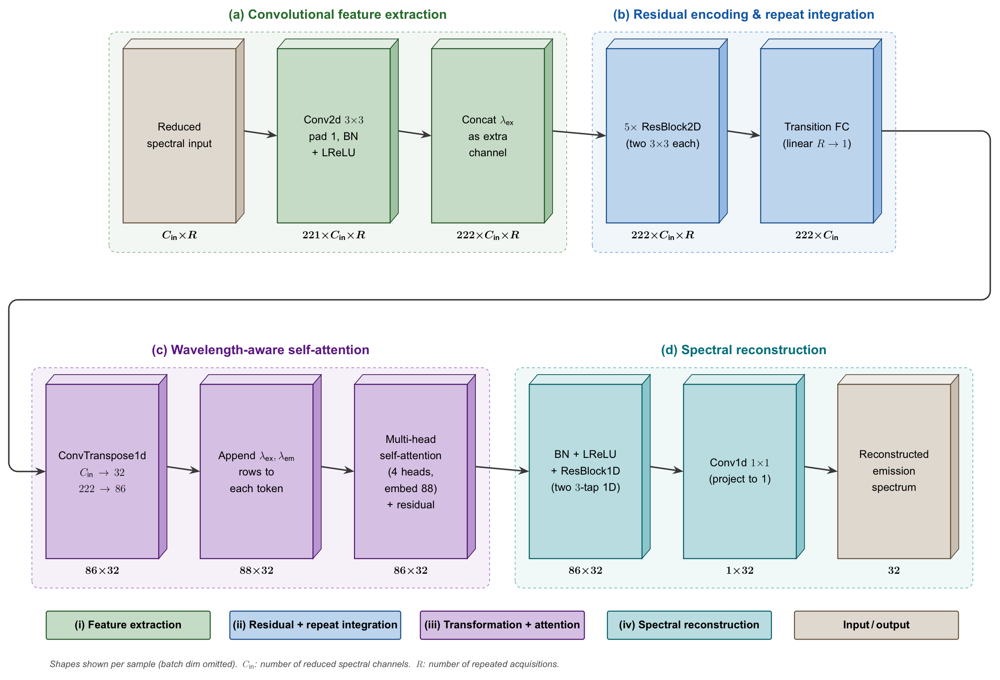

# PRESD

A deep learning pipeline for **spectral super-resolution** of fluorescence microscopy images. Given a reduced (4, 8, or 16 spectral channels) acquisition, the model reconstructs the full **32-channel** emission spectrum per pixel.

---

## Overview

Fluorescence spectral microscopy typically requires many spectral channels to resolve overlapping fluorophore signatures. This project trains a neural network (a wavelength-conditioned convolutional network with attention) to upscale low-channel spectral images to 32 channels, enabling faster acquisitions without sacrificing spectral resolution.

**Key features:**
- `prepare_data.py` builds the reduced input (4, 8 or 16 channels, any choice of repeats) and the 32-channel ground truth from the raw `.lsm` data
- Supports multiple acquisition repeats as input to improve reconstruction quality
- Excitation wavelength read from `Block N` in the filename (or set with `--wavelength`) to condition the network
- Outputs full 32-channel prediction as `.lsm`, per-pixel metric maps, and spectral plots
- Metrics (MAPE, SMAPE, RMSE, phasor distance) computed automatically when a ground-truth file is provided

---

## Repository Structure

```
.
├── prepare_data.py         # Builds input / ground-truth pairs from raw .lsm files
├── train.py                # Training script
├── test.py                 # Inference / evaluation script
├── NN.py                   # Model architecture (PRESD)
├── config.py               # Parameter loader (reads global_val.txt)
├── helper.py               # Utilities: normalization, metrics, wavelength parsing
├── plot.py                 # Training visualisation helpers
├── global_val.txt          # All hyperparameters and paths (edit here)
├── requirements.txt        # Python dependencies
├── docs/                   # Figures used in this README
└── models/                 # Pre-trained model weights
    ├── NN_4ch_1repeats.pt … NN_4ch_10repeats.pt    # 4-channel models  (1–10 repeats)
    ├── NN_8ch_1repeats.pt … NN_8ch_10repeats.pt    # 8-channel models  (1–10 repeats)
    └── NN_16ch_1repeats.pt … NN_16ch_10repeats.pt  # 16-channel models (1–10 repeats)
```

Model files are named `NN_<C_in>ch_<R>repeats.pt` — pick the one that matches the number of channels and the number of repeats you prepared the data with.

---

## Requirements

**Python 3.11.12**, in any environment (for example conda or `venv`)

```bash
pip install -r requirements.txt
```

| Package | Version |
|---|---|
| numpy | 1.26.4 |
| torch | 2.6.0 |
| tifffile | 2025.1.10 |
| matplotlib | 3.10.0 |
| tqdm | ≥ 4.66.0 |

A GPU is strongly recommended for training. `train.py` and `test.py` pick the device automatically: a CUDA GPU if available, otherwise the Apple-silicon GPU (MPS), otherwise the CPU. Inference runs on CPU as well.

---

## Downloading the Datasets

The datasets are hosted on Dropbox as a single archive, `Data.zip` (**~5.4 GB**).

**Option 1 — manual download:** open the [PRESD dataset folder on Dropbox](https://www.dropbox.com/scl/fo/xfy0tlok3evmm8a7fic96/AGMQA-5RCd6CYmoJM3caQlg?rlkey=3s1sxlfahbxz13krhqogfbxym&dl=0) and click **Download**.

**Option 2 — command line:** run the following from the **parent directory** of this repository (the `project-root/` shown below):

```bash
curl -L -o Data.zip "https://www.dropbox.com/scl/fo/xfy0tlok3evmm8a7fic96/AGMQA-5RCd6CYmoJM3caQlg?rlkey=3s1sxlfahbxz13krhqogfbxym&dl=1"
unzip Data.zip -d dataset
```

(`wget -O Data.zip "<same URL>"` works too.) Make sure you have at least ~11 GB of free disk space: about 5.4 GB for the archive plus room to extract it. You can delete `Data.zip` after extracting.

Either way, extract the data so that it sits **next to** (not inside) this repository, following the layout in the next section.

---

## Directory Layout & Where to Run

The large data folders live next to the repository, one level *above* it. Everything the scripts produce for you to look at (trained models, metrics, predictions and plots) is saved *inside* the repository:

```
project-root/
├── PRESD/                     # ← this repository (train.py, test.py, prepare_data.py, models/, …)
│   ├── models/                #    pre-trained weights (never overwritten)
│   ├── users_models/          # ← created by train.py: your trained weights
│   └── results/               # ← created by train.py / test.py: metrics, predictions, plots
│       ├── train/             #    training curves and metrics
│       └── test/              #    one folder per tested input file
├── dataset/                   # ← contents of Data.zip (raw 32-channel .lsm files)
│   ├── pos4_Image12Block_3.lsm
│   └── samp33_Image23Block_2.lsm
└── prepared/                  # ← created by prepare_data.py (input / gt pairs)
```

`Data.zip` puts the raw files directly in `dataset/`, so pass `--raw_folders ../dataset`. The prepared files then go to a sample folder named `dataset` (e.g. `../prepared/train_4ch_5rep/dataset`), which is the folder you pass to `train.py`. If you organise your own data into one folder per sample (e.g. `dataset/human/samp5/`, as in the examples below), each folder becomes its own sample. Run all commands from **inside the repository directory**, so that `../dataset`, `../prepared`, `users_models/` and `results/` resolve.

---

## Data Format

### Raw data (downloaded)
Each raw `.lsm` file is one field of view acquired **10 times** with all **32 spectral channels**:
```
shape = (10, 32, H, W)
```
The excitation wavelength is encoded in the filename as `Block N` (e.g. `Image 11 Block 5.lsm` → 561 nm, `pos4_Image12Block_3.lsm` → 488 nm; see `WAVELENGTH_BLOCK_1…7` in `global_val.txt`). `Block N`, `Block_N` and `BlockN` are all recognised, with or without a space before `Block`. Filenames are kept through every step, so this information is never lost.

### Prepared data (made by `prepare_data.py`)
For every raw file, `prepare_data.py` writes a pair with the **same filename**:

| File | Shape | Content |
|---|---|---|
| `input/<name>.lsm` | `(R, C_in, H, W)` | The repeats you select (`R` of them), each reduced from 32 to `C_in` channels by averaging groups of `32 / C_in` adjacent channels |
| `gt/<name>.lsm` | `(32, H, W)` | Ground truth: the mean of **all 10** repeats (always, regardless of the repeats selected for the input) |

`train.py` and `test.py` read `C_in` and `R` from the input files, so they need no `--channels` or `--repeats` option.

---

## Usage

The workflow has three steps: **prepare → train (optional) → test**.

### 1. Prepare input and ground truth

Choose the number of input channels (`4`, `8` or `16`) and any combination of repeats from `1` to `10`:

```bash
python prepare_data.py \
    --raw_folders ../dataset/human/samp5 ../dataset/human/samp10 \
    --channels 4 \
    --repeats 1 2 3 4 5 \
    --output_dir ../prepared/train_4ch_5rep
```

This creates:
```
../prepared/train_4ch_5rep/
├── prepare_info.json          # records the raw folders, channels and repeats used
├── samp5/
│   ├── input/Image 11 Block 5.lsm   # (5, 4, H, W)
│   └── gt/Image 11 Block 5.lsm      # (32, H, W)
└── samp10/ …
```

Prepare the **test samples the same way**, in a separate output folder, with the same `--channels` and the same *number* of repeats as the model you will use:

```bash
python prepare_data.py \
    --raw_folders ../dataset/human/samp12 \
    --channels 4 \
    --repeats 1 2 3 4 5 \
    --output_dir ../prepared/test_4ch_5rep
```

| Argument | Required | Description |
|---|---|---|
| `--raw_folders` | Yes | One or more folders of raw `.lsm` files, shape `(10, 32, H, W)` |
| `--channels` | Yes | Number of input channels: `4`, `8` or `16` |
| `--repeats` | Yes | Repeats used for the input, any of `1`–`10` (e.g. `1 3 5`) |
| `--output_dir` | Yes | Where to write `<sample>/input/` and `<sample>/gt/` |

### 2. Train (optional)

Skip this step to use a pre-trained model from `models/`. Otherwise pass the prepared sample folders:

```bash
python train.py \
    --data_folders ../prepared/train_4ch_5rep/samp5 ../prepared/train_4ch_5rep/samp10
```

All training folders must have been prepared with the same `--channels` and number of repeats. The trained model is saved as
`users_models/<C_in>_ch/<sample names>_<R>repeats/NN_<C_in>ch_<R>repeats.pt` — the same naming as the pre-trained models, but in a separate folder so the pre-trained weights in `models/` are never overwritten (`train.py` refuses to write there). Training metrics and plots go to `results/train/<C_in>_ch/<sample names>_<R>repeats/`. Both paths are printed in full when training finishes.

| Argument | Required | Description |
|---|---|---|
| `--data_folders` | Yes | Prepared sample folders, each containing `input/` and `gt/` |
| `--output_dir` | No | Root output directory (default: `results`, set by `PLOTS_DIR` in `global_val.txt`) |
| `--block` | No | Only train on files named `Block N` for this `N` (default: all) |
| `--harmonic` | No | Phasor harmonic used in the loss (default: 2) |
| `--model_name` | No | Custom name for the saved model (default: `NN_<C_in>ch_<R>repeats`) |
| `--model_dir` | No | Root folder for trained weights (default: `USER_MODELS_DIR` = `users_models`) |
| `--processes` | No | Number of data-loading processes (default: 75% of CPUs) |

### 3. Test (inference)

Run a model on one prepared input file. The model must match the input's `C_in` and `R`: for an input prepared with `--channels 4 --repeats 1 2 3 4 5`, use `NN_4ch_5repeats.pt` — either the pre-trained one in `models/` or one you trained.

**With ground truth (computes metrics and comparison plots):**
```bash
python test.py \
    --model_path models/NN_4ch_5repeats.pt \
    --input_file "../prepared/test_4ch_5rep/samp12/input/Image 11 Block 5.lsm" \
    --gt_file    "../prepared/test_4ch_5rep/samp12/gt/Image 11 Block 5.lsm" \
    --wavelength 561
```
Without `--output_dir`, outputs go to `results/test/<input file name>/`, here `results/test/Image 11 Block 5/`.

**With your own trained model, without ground truth:**
```bash
python test.py \
    --model_path users_models/4_ch/samp5_samp10_5repeats/NN_4ch_5repeats.pt \
    --input_file "../prepared/test_4ch_5rep/samp12/input/Image 11 Block 5.lsm" \
    --wavelength 561 \
    --output_dir results/test/samp12_block5_own
```
Pass `--output_dir` when you test the same input with more than one model; otherwise each run overwrites the previous one in `results/test/<input file name>/`.

| Argument | Required | Description |
|---|---|---|
| `--model_path` | Yes | `models/NN_<C_in>ch_<R>repeats.pt` or your own trained model |
| `--input_file` | Yes | Prepared input `.lsm` file, shape `(R, C_in, H, W)` |
| `--wavelength` | No | Excitation wavelength in nm (405, 458, 488, 514, 561, 591, or 633). Default: read from `Block N` in the input filename |
| `--output_dir` | No | Directory where outputs are saved (default: `results/test/<input file name>/`) |
| `--gt_file` | No | Matching prepared GT `.lsm` file, for metrics |

---

## Outputs

Everything is saved inside the repository folder, and each script prints the full path of its output folder when it finishes.

| What | Where (default) |
|---|---|
| Prepared input / GT pairs | `--output_dir` of `prepare_data.py`, e.g. `../prepared/train_4ch_5rep/` |
| Your trained model weights | `users_models/<C_in>_ch/<sample names>_<R>repeats/NN_<C_in>ch_<R>repeats.pt` |
| Training metrics and loss curves | `results/train/<C_in>_ch/<sample names>_<R>repeats/` (`<model_name>_metrics.json`, `loss_comparison.png`, `comparison_results.npz`) |
| Test predictions, metrics and plots | `results/test/<input file name>/`, or `--output_dir` if given (contents below) |

Contents of a test output folder:

| File / Folder | Condition | Description |
|---|---|---|
| `pred32.lsm` | Always | Predicted 32-channel image, shape `(32, H, W)` |
| `metrics.json` | GT provided | Overall MAPE, SMAPE, RMSE, Phasor h1/h2 |
| `channels/channel_XX.png` | Always | Per-channel spatial images. With GT: 5 panels (GT \| Pred \| SMAPE \| Abs. error \| Phasor h2). Without GT: Pred only. |
| `spectra/spectrum_XX.png` | Always | 50 random pixel spectra showing Pred (red), GT (blue, if available), and input as a step/box plot (green) |

---

## Configuration

All parameters are set in `global_val.txt`. Key settings:

| Parameter | Description |
|---|---|
| `EPOCHS` | Number of training epochs |
| `MAX_SAMPLES` | Total pixels sampled for training, split evenly across files |
| `BATCHSIZE` | Training batch size |
| `INITIAL_LR` | Initial learning rate |
| `LAMBDA_PHASOR` | Weight for the phasor loss term |
| `NORM` | `log` applies `log1p` to inputs and targets; any other value disables normalization |
| `PLOTS_DIR` | Root output folder (default `results`, inside the repo): `train.py` writes to `results/train/`, `test.py` to `results/test/` |
| `USER_MODELS_DIR` | Where `train.py` saves trained weights (default `users_models`, never `models/`) |
| `WAVELENGTH_BLOCK_1…7` | Excitation wavelengths per block (405–633 nm). During training, the wavelength of each file is taken from `Block N` in its filename (e.g. `Image_11_Block_1.lsm` → 405 nm) |

> **Note:** the training settings in `global_val.txt` are set for a quick run: `EPOCHS 10` and `MAX_SAMPLES 100000`. The pre-trained models in `models/` were trained for **100 epochs on 1M samples** (`EPOCHS 100`, `MAX_SAMPLES 1000000`). Use those values to train a model of the same quality.

---

## Model Architecture

<p align="center">
  
</p>

*PRESD architecture (Supplementary Fig. S13). Shapes are per pixel; `C_in` is the number of reduced spectral channels and `R` the number of repeated acquisitions.*

`PRESD` (`NN.py`) reconstructs a 32-channel emission spectrum for each pixel from a reduced spectral input of size `C_in × R` (`C_in` reduced spectral channels, `R` repeated acquisitions). It has four stages:

| Stage | Layers | Output (per pixel) |
|---|---|---|
| **(a) Convolutional feature extraction** | Conv2d 3×3 (pad 1) + BatchNorm + LeakyReLU (α = 0.01) | `221 × C_in × R` |
| | Concatenate the excitation wavelength λ_ex as an extra channel | `222 × C_in × R` |
| **(b) Residual encoding & repeat integration** | 5 × ResBlock2D (two 3×3 convs each, identity skip) | `222 × C_in × R` |
| | Transition FC (linear `R → 1` along the repeat axis) | `222 × C_in` |
| **(c) Wavelength-aware self-attention** | ConvTranspose1d (`C_in → 32` spectral, `222 → 86` features) | `86 × 32` |
| | Append λ_ex and the detection-channel centre wavelength λ_em to each of the 32 tokens | `88 × 32` |
| | Multi-head self-attention (4 heads, embed 88) + residual, keep the 86 feature rows | `86 × 32` |
| **(d) Spectral reconstruction** | BatchNorm + LeakyReLU + ResBlock1D (two 3-tap 1D convs) | `86 × 32` |
| | Conv1d 1×1 (project to 1) | `32` |

**Loss** = MSE + λ_consistency · consistency (output channel groups vs. input channels) + λ_phasor · phasor (G, S) distance.

Input tensor shape: `(batch, 1, C_in, R)`; output shape: `(batch, 32)`.

---

## License

Released under the MIT License — see the [`LICENSE`](LICENSE) file for details.
